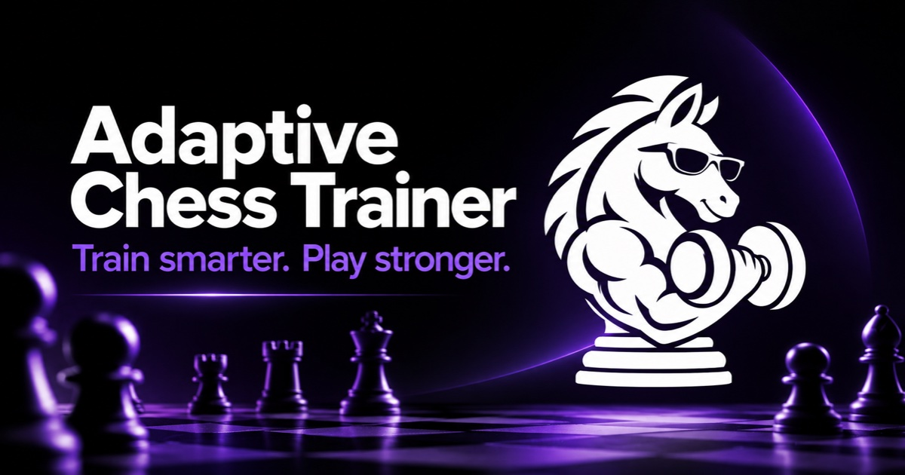
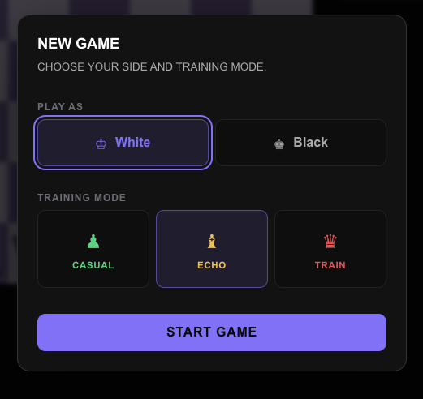
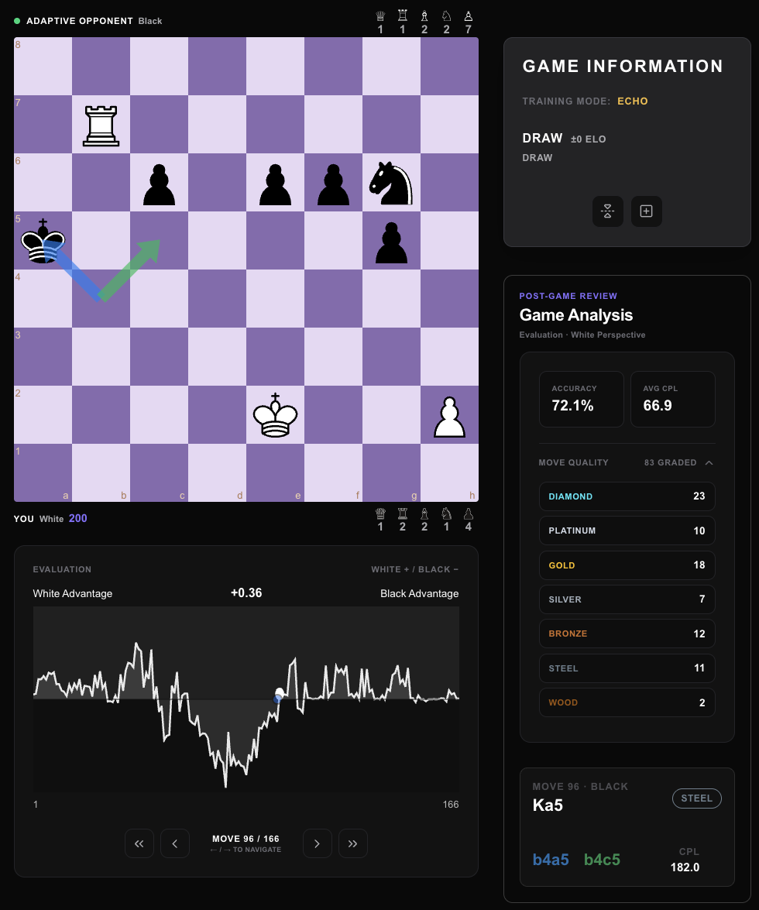
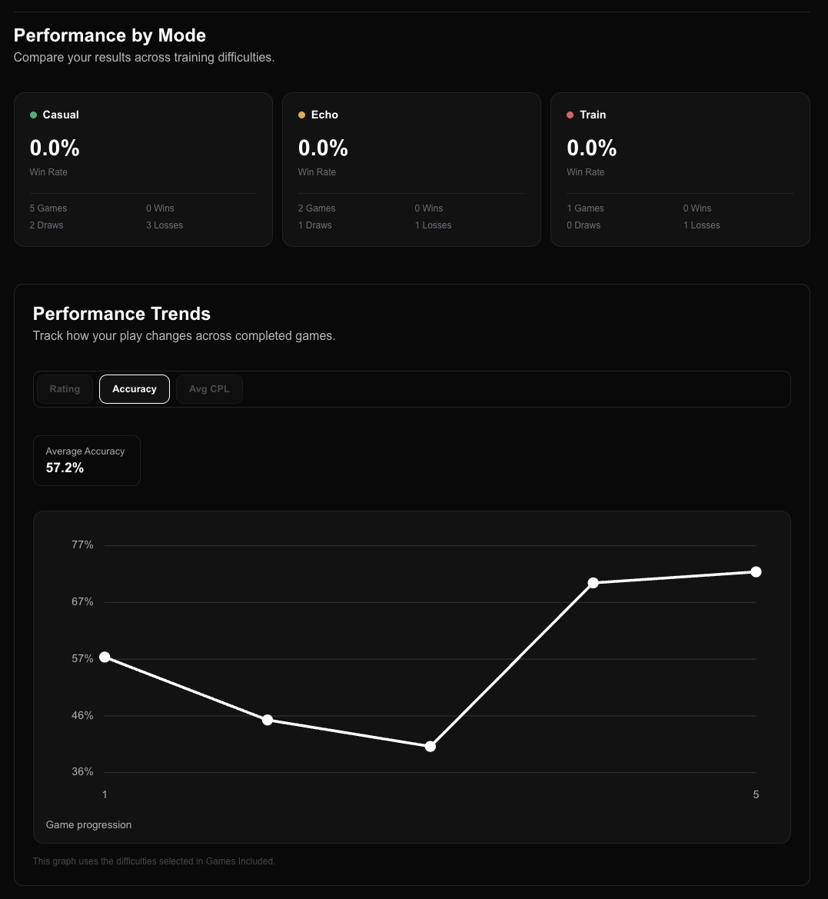

# Adaptive Chess Trainer

*A chess training experience that evolves with your skill.*

**[Play Live Application →](https://chess.varunsr.com/app)**

  

## Overview

Adaptive Chess Trainer is a browser chess application. You play a full game against a Stockfish opponent whose target strength follows an estimate of your play, instead of a single fixed rating that stays put for the whole session.

That estimate moves as you play. The engine evaluates your decisions, the estimate updates, and the opponent’s next target follows the selected training mode. After the game, each move is reviewed on a seven-tier quality scale so you can see which decisions held up.

## Key Features

- **Adaptive Opponent.** A Stockfish-powered opponent whose playing strength is set from your estimated skill and the training mode you chose.
- **Three Difficulty Modes.** Casual plays below your estimated level, Echo plays near it, and Train plays above it.
- **Real-Time Skill Estimation.** The rating estimate updates during the game from how your moves compare with the engine’s evaluation.
- **Post-Game Analysis.** Finished games are reviewed move by move and labeled on seven tiers, from strongest to weakest: Diamond, Platinum, Gold, Silver, Bronze, Steel, and Wood.
- **Player Profiles.** Guest progress stays in the browser. Signed-in players keep a cloud profile with results, rating, accuracy, move-quality counts, trends, and recent games.
- **Gameplay Controls.** Play with promotions, undo, and board flip. Personalize the accent color, board theme, piece set, and interface appearance.

## Application Showcase

#### Adaptive Difficulty

Casual, Echo, and Train set the opponent below, near, or above your estimated rating. The target is that estimate plus the mode’s offset, then limited to the strength range Stockfish is asked to play.

  

#### Post-Game Analysis

After the game, Stockfish evaluations are turned into the seven move-quality tiers so you can review individual decisions, not only the final result.

  

#### Player Profile

The profile keeps the estimated rating, peak rating, results, accuracy, average centipawn loss, move-quality counts, progress trends, and recent games. Guests store this on the device. A signed-in account syncs it through Supabase, and guest progress can be imported into an empty account.

  

## Tech Stack

| Category | Technologies |
| --- | --- |
| Frontend | React, TypeScript, Vite |
| Chess Engine | Stockfish 19, chess.js |
| Chess Interface | react-chessboard |
| Backend & Data | Supabase |
| Testing | Vitest |
| Deployment | Vercel |

The live trainer is deployed at [chess.varunsr.com/app](https://chess.varunsr.com/app). Opponent play and analysis run in the browser through the Stockfish.js 19 Lite worker.

## Engineering Highlights

**Adaptive Difficulty Engine**

Each training mode applies a fixed offset to the current rating estimate: below it for Casual, slightly below it for Echo, and above it for Train. As the estimate changes from move to move, the opponent’s target strength is recalculated for the next search, within Stockfish’s configured Elo bounds.

**Stockfish Integration**

The app runs Stockfish.js in Web Workers. The opponent search requests multiple principal variations (MultiPV) and chooses a move that fits the target strength. Separate analysis passes evaluate the player’s moves during the game and again in the post-game review.

**Move Classification**

Post-game review compares each played move with the engine evaluation and maps that result onto seven custom tiers, from Diamond down to Wood. The scale is the application’s own labeling of those evaluations, not a Stockfish feature.

## Testing & Reliability

The project uses Vitest and Testing Library. The suite covers chess rules, opponent selection, rating updates, move classification, profiles, authentication return URLs, and persistence safety, including revision checks that keep a stale cloud write from replacing a newer profile. The latest full run is 608 tests across 76 files, all passing.

## Licensing & Attribution

Opponent play and move analysis use the lite single-threaded Stockfish.js 19 worker shipped in `public/stockfish/`. Stockfish.js 19 Lite is © 2026 Chess.com, LLC, licensed under the GNU GPLv3, and is based on Stockfish by T. Romstad, M. Costalba, J. Kiiski, G. Linscott, and other contributors. That license applies to Stockfish.js. It does not relicense the original Adaptive Chess Trainer application.

The GPLv3 text and corresponding-source notes are in [`licenses/stockfish-GPL-3.0.txt`](licenses/stockfish-GPL-3.0.txt) and [`licenses/stockfish-corresponding-source.md`](licenses/stockfish-corresponding-source.md). The full third-party notice is [`THIRD_PARTY_LICENSES.md`](THIRD_PARTY_LICENSES.md).

Piece artwork for the Modern and Minimal sets is credited in [`public/pieces/ATTRIBUTION.md`](public/pieces/ATTRIBUTION.md). Modern (Chessnut, by Alexis Luengas) is Apache License 2.0. Minimal (Spatial, by Maurizio Monge) is MIT.
